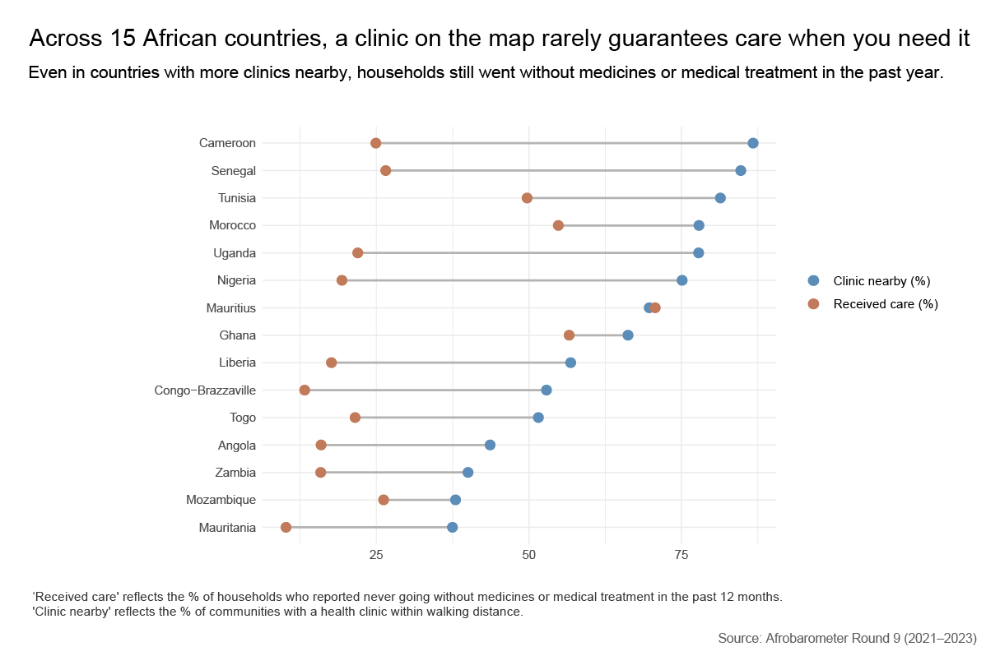
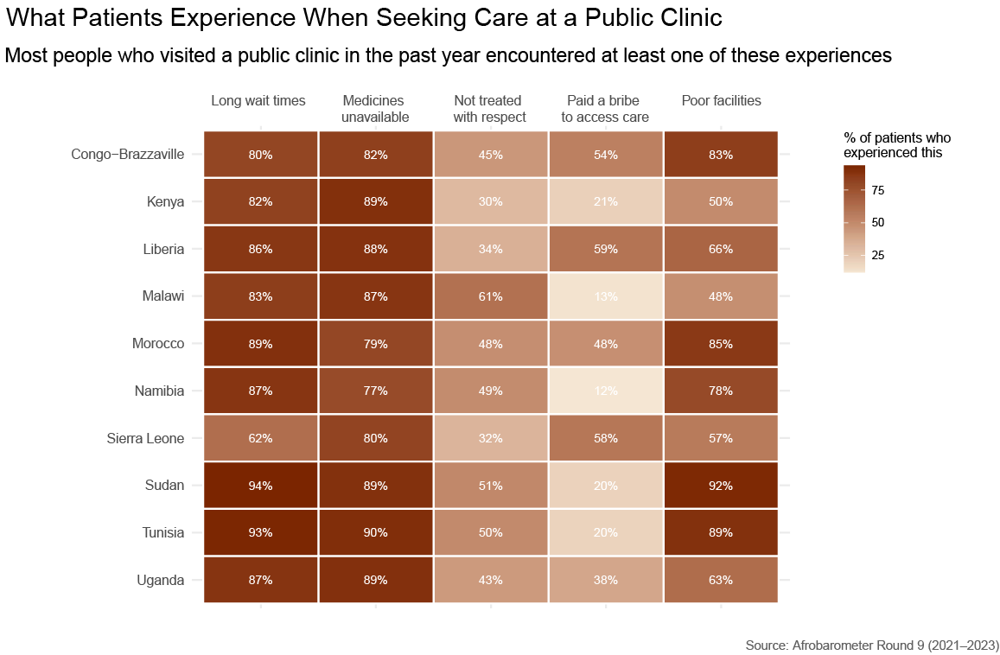
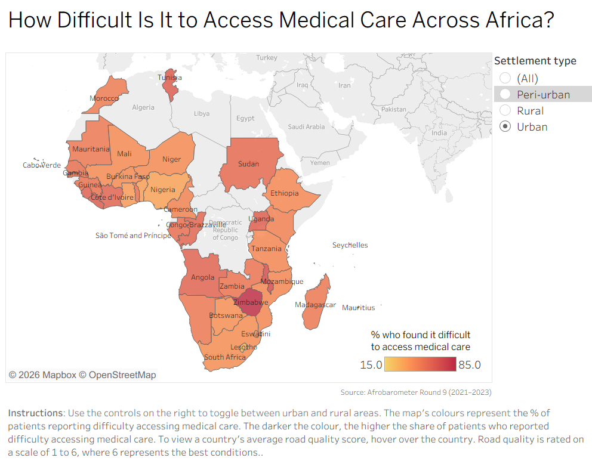

[Download the full data story (PDF)](data-story.pdf){.btn .btn-primary}

When it comes to healthcare, the right infrastructure can mean the difference between life and death. But what happens when the infrastructure exists on paper but millions still go without care? Data collected through Round 9 of the Afrobarometer survey (2021-23) reveals a sharp disconnect across 39 countries in Africa. Bad roads can make the journey to accessing health facilities arduous, but the story doesn't necessarily end there. For those who make it to a clinic, their experience there might matter just as much, if not more. Of the many factors that affect health-seeking behaviour, this story examines two possible explanations for low uptake of healthcare services in countries on the African continent.

## Proximity to a clinic doesn't guarantee access to medicines or medical treatment

Data shows that having a health clinic within walking distance does not automatically translate to access to medical care. In Cameroon, for instance, over 85% of communities had a clinic nearby, however, nearly 75% of households still reported going without medicines or medical treatment in the past 12 months. In contrast, Mauritius, one of Africa's higher-income countries, shows nearly equal shares of clinic access and care received. It offers a glimpse of what the relationship between proximity and care could look like.

{fig-alt="Dumbbell chart for 15 African countries comparing the % of communities with a clinic nearby with the % of households that received care. In most countries the clinic-nearby value is far higher; in Mauritius the two are nearly equal."}

Perhaps more relevant to understanding why people go without care is to ask: what happens once you do get to the clinic?

## Patient experiences highlight troubling realities in public clinics

Responses regarding experiences with the healthcare system provide some striking insight into the various challenges patients encounter. Of those who sought care at a public clinic, 1 in 2 in Liberia and Sierra Leone paid a bribe to healthcare workers in order to access care. A shockingly large share also reported medicines being unavailable and facing long wait times. The lack of respect also emerged as a theme in some countries. In Malawi, over 60% of patients reported not being treated with respect by healthcare workers or clinic staff. It is reasonable to assume that feeling disrespected discourages return visits, and this may be especially true for women and vulnerable groups who already face social barriers to seeking care.

{fig-alt="Heatmap with 10 countries as rows and five patient experiences as columns (long wait times, medicines unavailable, not treated with respect, paid a bribe to access care, poor facilities). Darker cells mean a higher share of patients; long waits and unavailable medicines are high almost everywhere."}

## Where You Live Within a Country Could Shape Your Access to Care

Whether roads are passable determines whether a clinic within walking distance is truly accessible. The interactive map allows readers to explore road quality by country (by hovering on a country) and while the relationship between road conditions and difficulty accessing care is not uniform, countries at the harder end of the access spectrum like Zimbabwe, have relatively lower average road quality scores.

Filtering by rural and urban area does not reveal any clear patterns either. In some countries urban residents report greater difficulty accessing care than rural ones (eg. Zimbabwe); in others the reverse is true (eg. Sudan).

{fig-alt="Choropleth map of Africa shaded from light yellow (15%) to dark red (85%) by the share of people who found it difficult to access medical care. Zimbabwe is the darkest country; the settlement-type filter is set to Urban."}

<!--
Once the Tableau Public viz is published, replace the static image above
with an embedded interactive version (swap in the real URL):

<iframe src="https://public.tableau.com/views/YOUR_WORKBOOK/YOUR_SHEET?:showVizHome=no&:embed=true"
        width="100%" height="800" style="border:0;" title="How Difficult Is It to Access Medical Care Across Africa?"></iframe>
-->

## The Missing Piece

What the data does suggest is that healthcare access in Africa is not easily generalisable. Distance alone is not the biggest constraint. Where you live matters, but patient experiences, availability of medicines, corruption and poor roads all build on each other in ways that a single indicator cannot and does not capture. So until facility capacity, quality of care and supporting infrastructure move forward together, access in theory and the care received in practice will remain two very different things.

## Data and tools

- **Data:** Afrobarometer Round 9 (2021-23)
- **Tools:** R for the static charts; Tableau for the interactive map

## Chart design notes

**Heatmap (what patients experience at a public clinic).** This visualization is intended for a general audience of readers, policymakers, and global health advocates. It uses a waffle-style heat tile map to show self-reported negative experiences in public health facilities across selected countries, based on Afrobarometer Round 9 data. Countries are listed alongside key issues such as long wait times, unofficial payments, and medicine shortages, with each tile representing the share of respondents reporting each experience. Darker shades indicate higher prevalence, allowing quick comparison across countries and types of service failures, highlighting differences in quality of care that patients experience.

**Dumbbell chart (clinic nearby versus care received).** This visualization is intended for a general audience of readers, policymakers, and global health advocates. It uses a dumbbell plot to compare the proportion of communities with a health clinic within walking distance against the share of households reporting they received needed medical care across selected African countries. The purpose of this visualization is to challenge the assumption that geographic access to clinics alone is sufficient for people to receive care when they need it. It highlights that improving health outcomes requires not just building facilities closer to people, but ensuring that those facilities are usable, trusted, and able to meet demand.

**Interactive map (difficulty accessing care).** This visualization is intended for a general audience of readers, policymakers, and global health advocates. It uses an interactive map to show the share of people reporting difficulty accessing healthcare after visiting a public clinic, alongside average road quality by country. The map highlights how infrastructure shapes access to care. Countries with poorer road conditions, such as Zimbabwe, tend to report higher difficulty accessing services, though the relationship is not consistent across all contexts. Differences between rural and urban areas also vary widely, with no uniform pattern across countries. The purpose of this visualization is to show that access to healthcare depends not only on distance to facilities, but also on the quality of infrastructure.

Source for all three: Afrobarometer Round 9 Survey Data, [afrobarometer.org/surveys-and-datasets/round-9-data](https://www.afrobarometer.org/surveys-and-datasets/round-9-data/)
