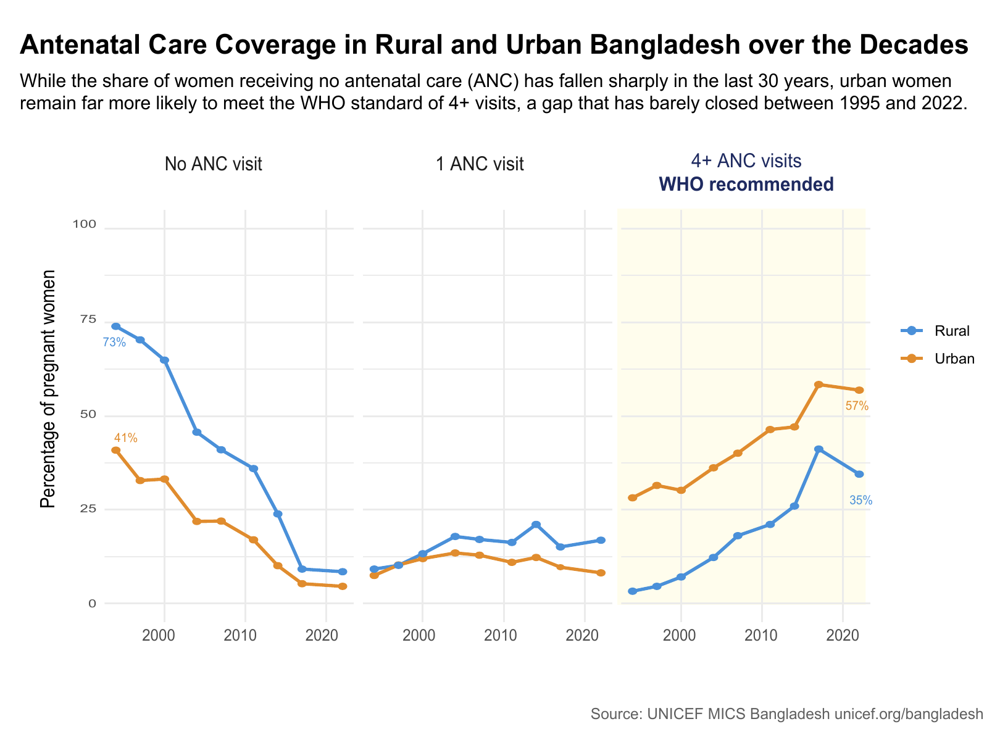

{fig-alt="Three side-by-side line charts (no ANC visit, 1 ANC visit, 4+ ANC visits) showing the percentage of pregnant women in Bangladesh over time, with separate lines for rural and urban women. The share with no visits falls sharply, while urban women stay well ahead of rural women on four or more visits."}

## Purpose & audience

This visualization is intended for public health policymakers, maternal health advocates, and the general public. It is designed to be interpreted even without deep statistical expertise. The faceted line chart tracks antenatal care (ANC) coverage among pregnant women in Bangladesh from the mid-1990s to the early 2020s, disaggregated by rural and urban residence across three levels of care:

i. no visits,
ii. one visit, and
iii. four or more visits. (this being the WHO-recommended standard).

What we see is a persistent and meaningful urban-rural gap. Rural women have historically been far more likely to receive no antenatal care at all, while urban women are consistently more likely to achieve the WHO-recommended threshold of four or more visits. Although both groups show improvement over time, the gap has not closed. By the early 2020s, rural women still fall behind urban women on adequate care coverage by roughly 20 percentage points.

## Sources

- [data.unicef.org/topic/maternal-health/antenatal-care](https://data.unicef.org/topic/maternal-health/antenatal-care/)
