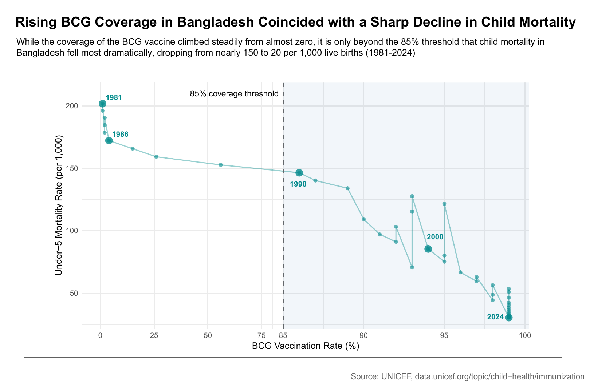

{fig-alt="Connected scatterplot for Bangladesh, 1981-2024. The x-axis is BCG vaccination rate (0 to 100%) and the y-axis is under-5 mortality per 1,000. Points start near 0% coverage and about 200 deaths per 1,000, then move right and down, with the steepest decline after the dashed 85% coverage threshold."}

## Purpose & audience

This visualization is intended for public health policymakers and global health advocates, and is designed to be accessible to audiences with limited technical knowledge. The scatterplot, connected by a line, highlights Bangladesh's trajectory from 1981 to 2024, showing the relationship between BCG vaccination coverage and under-5 mortality rates over time. The chart indicates that as vaccination rates rose from close to zero to above 85%, child mortality fell dramatically, from over 200 deaths per 1,000 to roughly 20. However, the steepest decline occurs after Bangladesh crosses the 85% vaccine coverage threshold. The intended takeaway is that improving vaccine coverage, particularly past critical thresholds, is one of the most effective levers available for reducing child mortality.

## Sources

- UNICEF Child Health and Immunization Database: [data.unicef.org/topic/child-health/immunization](https://data.unicef.org/topic/child-health/immunization)
- [www.childmortality.org](https://www.childmortality.org)
