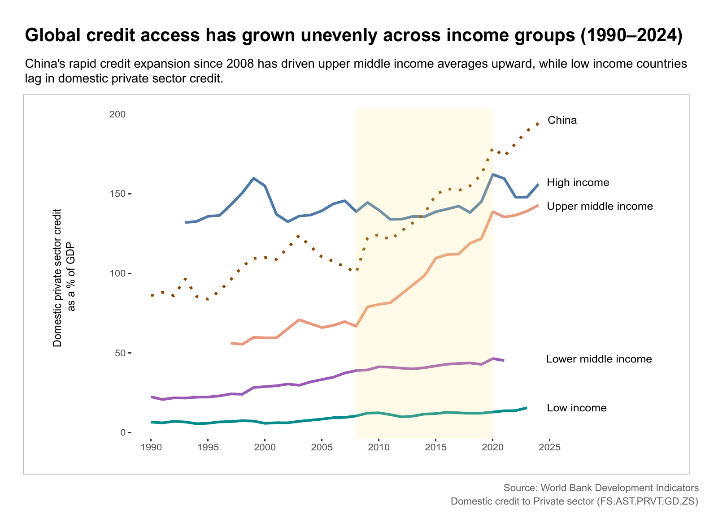

{fig-alt="Line chart from 1990 to 2024 of domestic credit to the private sector as a percentage of GDP. China rises sharply after 2008 toward 200%, above the high income line; upper middle income rises with it; lower middle income is lower; low income stays near the bottom with hardly any increase."}

## Purpose & audience

This visualization is intended for policymakers, economists and the general public, and is meant to be accessible without prior technical knowledge. The line chart tracks domestic credit to the private sector as a percentage of GDP across four World Bank income groups and China from 1990 to 2024. While high income countries have maintained consistently high credit levels throughout the period, the most striking trend is China's rapid expansion since 2008, which has seen it surpass high income averages and approach 200% of GDP by 2024, thus also driving the remarkable growth we see in the upper middle income credit levels.

At the same time, low income countries have roughly under 15% throughout with hardly any increase.

## Sources

- World Bank open database: [FS.AST.PRVT.GD.ZS](https://data.worldbank.org/indicator/FS.AST.PRVT.GD.ZS)
