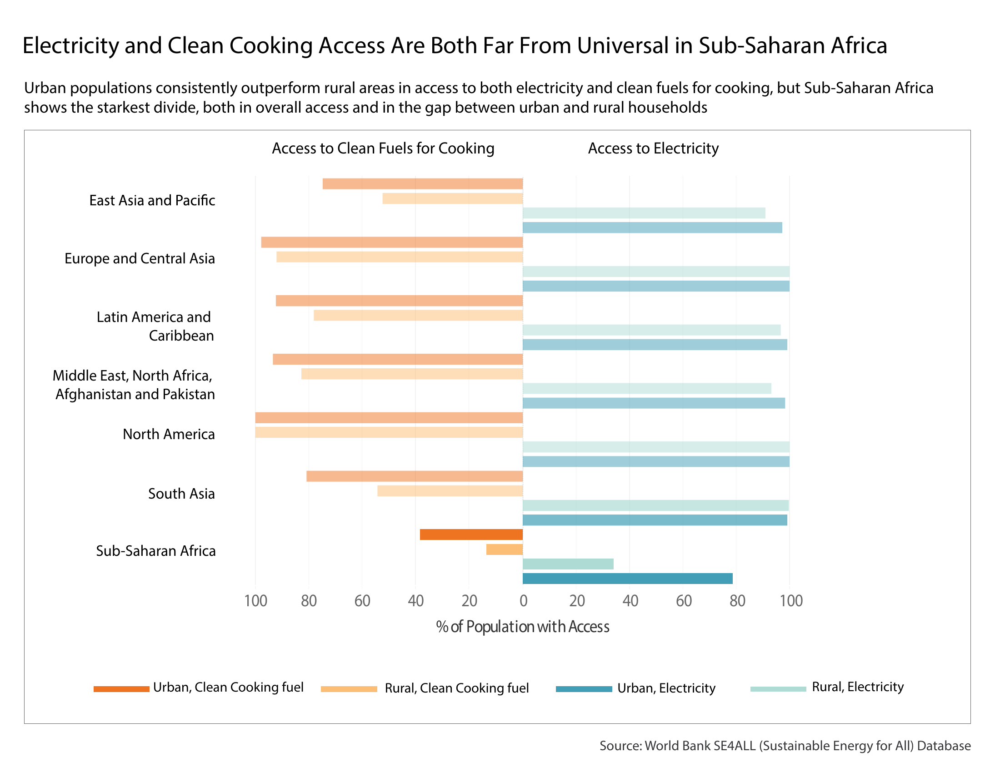

{fig-alt="Diverging bar chart by world region showing the percentage of the population with access to clean fuels for cooking (left) and electricity (right), split into urban and rural. Sub-Saharan Africa shows the lowest access and the largest urban-rural gaps."}

## Purpose & audience

This visualization is intended for policymakers, development practitioners, and anyone interested in global energy access. It compares access to electricity and clean cooking fuels across regions, and is further broken down by urban and rural populations. The goal is to show how access differs not just across regions, but also between electricity and clean cooking and to highlight gaps in household energy access. So while electricity access is almost identical between rural and urban areas for most world regions, clean cooking access remains significantly lower and depends on urbanisation levels. Sub-Saharan Africa specifically sees a stark divide in rural vs urban and also access to electricity vs clean cooking fuel when compared to the rest of the world.

## Sources

- World Bank, World Development Indicators, SE4ALL: [data360.worldbank.org/en/dataset/WB_SE4ALL](https://data360.worldbank.org/en/dataset/WB_SE4ALL)
