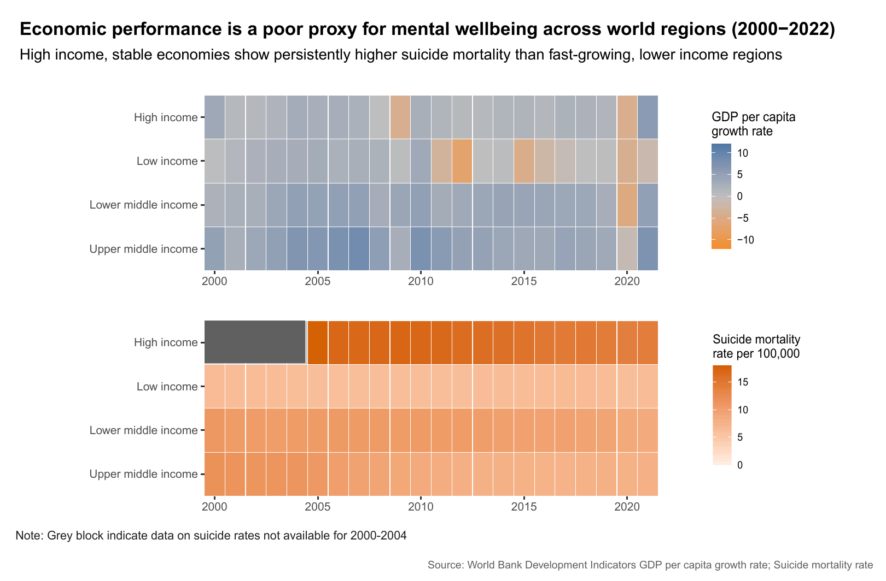

{fig-alt="Two stacked heatmaps with years 2000 to 2022 on the x-axis and four income groups on the y-axis. The top shows GDP per capita growth, with contractions around 2008 and 2020. The bottom shows suicide mortality per 100,000, which stays similar or declines slowly and is highest for high income countries; a grey block marks missing data for 2000-2004."}

## Purpose & audience

This visualization is intended for policymakers and mental health researchers, and is designed to be accessible with limited prior technical knowledge if any. The two heatmaps intend to show the disconnect between economic performance and mental health outcomes across income groups from 2000 to 2022. GDP per capita growth rates fluctuate sharply, with notable contractions in 2008 (due to the financial crisis) and 2020 (due to the COVID-19 pandemic). At the same time, suicide mortality rates remain more or less the same or decline only gradually over the same period. High income countries, despite steady economic recovery after 2010, record some of the highest suicide mortality rates globally.

## Sources

- World Bank open database: [NY.GDP.PCAP.KD.ZG](https://data.worldbank.org/indicator/NY.GDP.PCAP.KD.ZG)
- World Bank open database: [SH.STA.SUIC.P5](https://data.worldbank.org/indicator/SH.STA.SUIC.P5)
