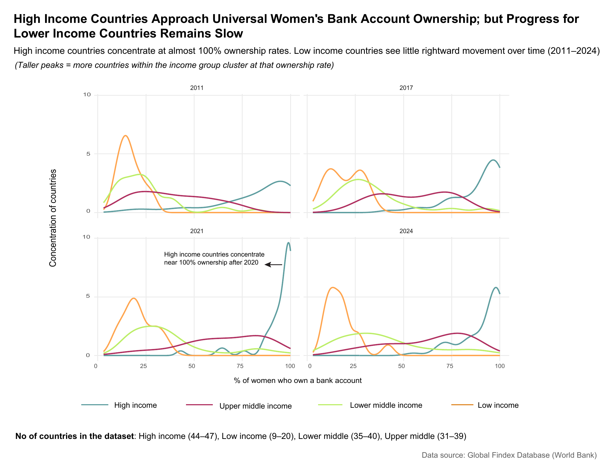

{fig-alt="Faceted density plots of the percentage of women who own a bank account, with one line per income group in each survey year (2011, 2017, 2021, 2024). High income countries concentrate near 100% ownership after 2020, while low income countries show little rightward movement over time."}

## Purpose & audience

This visualization looks at how the share of women with bank accounts has shifted across countries at different income levels, from 2011 to 2024, using data from the World Bank's Global Findex Database. The audience again are policy stakeholders and development researchers. The purpose is to show that progress on women's financial access has not been evenly distributed. High income countries show a sharp rightward shift in their distribution after 2021, likely due to payment digitization during and after the COVID-19 pandemic. Despite the expansion of mobile money in Sub-Saharan Africa from around 2014, low income countries show little movement in the share of women who own bank accounts across the 4 survey years.

## Sources

- Global Findex Database (World Bank)
