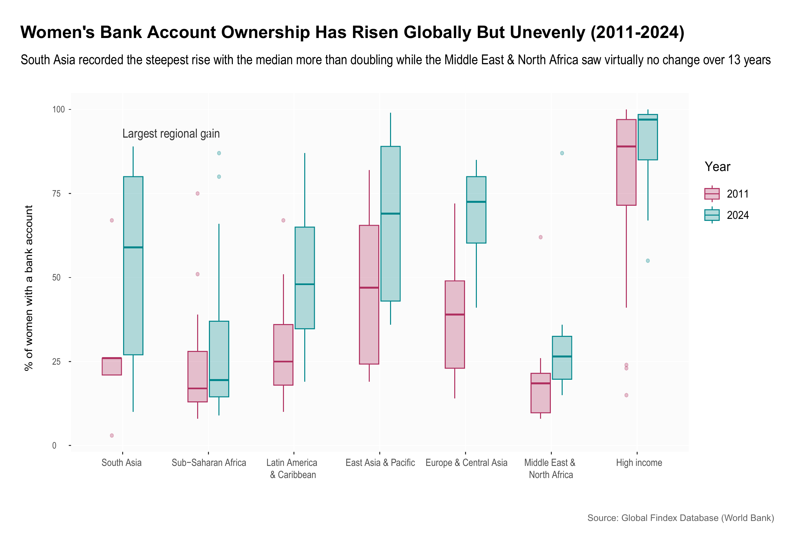

{fig-alt="Boxplots of the percentage of women with a bank account by region, comparing 2011 and 2024. South Asia shows the largest gain, with its median more than doubling, while the Middle East and North Africa shows virtually no change."}

## Purpose & audience

This visualization presents female bank account ownership rates across World Bank regions in 2011 and 2024. The intended audience is policymakers and development researchers (not the layperson) interested in the topic of women's financial inclusion. The purpose is to support the point that while account ownership has expanded globally over the past thirteen years, progress has been largely uneven across geographical regions. Some regions like South and East Asia recorded dramatic gains in the median while some like the Middle East and North Africa have barely moved. The audience should be able to compare both the level and spread of ownership rates within regions, and point out the regions in which distributions have shifted versus remained flat.

## Sources

- Global Findex Database (World Bank)
